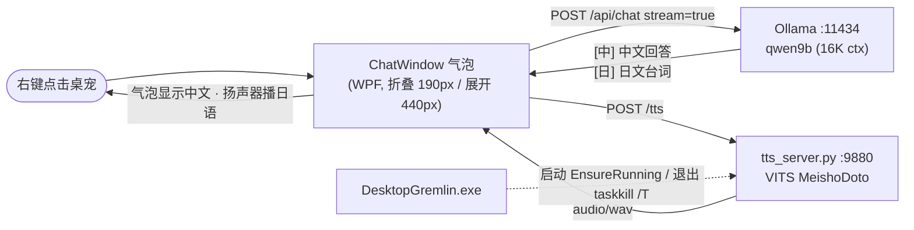

# local-llm-uma-pet

> 本地大模型驱动的赛马娘桌面宠物 — 全部离线运行，不联网、不调云端 API、零 token 成本。
>
> **大脑** Qwen3.5-9B (Ollama) · **嘴** UmaChat VITS (CPU) · **身体** DesktopGremlin v4.0 (C#/WPF)

右键点一下趴在桌面上的马娘，弹出粉色气泡，跟她说话。她说中文，同时用日语念给你听。

---

## 它是怎么跑起来的



一句话链路：**点桌宠 → 气泡 → 本地模型 → 双语输出 → 中文显示 + 日语朗读**。

三处关键设计：

- **模型按 `[中]/[日]` 双行输出**，程序拆开后分别处理，解决"中文 TTS 音色难听、日语模型又说不好中文"这个矛盾。
- **TTS 服务跟着桌宠生命周期走**，桌宠不开它就不在；`--parent-pid` 兜底强杀/崩溃场景。
- **TTS 空闲 600 秒自动卸载**，常驻内存 786MB → 8.8MB，重载 0.4 秒。

---

## 三块拼图

| 环节 | 上游项目 | 本仓库做的事 |
|---|---|---|
| 本地大模型 | [Qwen3.5-9B](https://ollama.com/library/qwen3.5) via [Ollama](https://ollama.com) | `Modelfile` 8GB 显存安全配置、一键安装、参数自查、关思考问答脚本 |
| 语音合成 | [kagari-bi/UmaChat_WebApi](https://github.com/kagari-bi/UmaChat_WebApi) `63a70cf` | `tts_server.py` 把 VITS 包成 HTTP 服务，含父进程守卫、空闲卸载 |
| 桌宠本体 | [Kritzkingvoid/Desktop_Gremlin](https://github.com/Kritzkingvoid/Desktop_Gremlin) `v4.0` (`0a7bd2c`) | C# 原生集成聊天窗 + TTS 管家；Python 外挂版备用 |

上游源码**不在本仓库**，按上面的链接 + commit 自行获取。`pet/csharp/` 里放的是本项目新增/改写的 C# 文件，覆盖到上游同名位置即可。

---

## 快速开始

### 0. 前提

- Windows 10/11 + 一张 ≥8GB 显存的 N 卡（无卡也能跑，速度掉到个位数 tok/s）
- Python 3.11、.NET Framework 4.8

### 1. 装大脑（约 6.6GB 下载）

```bat
cd llm
install.bat
```

自动装 Ollama、写显存优化环境变量、拉 `qwen3.5:9b`、生成 `qwen9b` 和 `qwen9b32k` 两个模型。

验证：

```bat
ollama ps          :: 应显示 100% GPU
check-params.bat   :: 四项参数一次看清
```

### 2. 装嘴

```bash
git clone https://github.com/kagari-bi/UmaChat_WebApi /tmp/umachat
cp -r /tmp/umachat/src  tts/src
# 模型：huggingface.co/gouhuo/Umamusume_Vits_models → tts/models/MeishoDoto/
cd tts
python -m venv venv
venv/Scripts/pip install torch torchaudio numpy flask pyopenjtalk-plus
start-tts.bat
```

`curl --noproxy "*" http://127.0.0.1:9880/health` 返回 `{"ok":true}` 即成功。

### 3. 装身体

```bash
git clone --branch v4.0 https://github.com/Kritzkingvoid/Desktop_Gremlin pet/src40
cp pet/csharp/*.cs pet/csharp/*.xaml  pet/src40/Desktop_Gremlin/
```

然后按 [`docs/03-桌宠集成.md`](docs/03-桌宠集成.md) 打三处补丁（右键入口、退出清理、配置项），双击 `build.bat` 编译。

> 素材（PNG 精灵图）在 Desktop_Gremlin 的 **release zip** 里，GitHub 仓库只有 28 张样例。编译不需要它们，运行时需要。

---

## 实测数据

RTX 3060 Ti 8GB · 驱动 617.14 · Ollama 0.40.14，均为实测非推算。

| 项 | 数值 |
|---|---|
| `qwen9b` 16K 上下文 | 7749 MiB / **100% GPU** / 63 tok/s |
| `qwen9b32k` 32K 上下文 | 7851 MiB / 100% GPU / 48 tok/s（余量仅 ~340MB） |
| 首字延迟（冷加载） | 8–10 秒（磁盘读 6.6GB 约 45 秒，之后复用显存） |
| TTS 推理 | CPU，RTF 0.33（比实时快 3 倍），不占显存 |
| TTS 空闲卸载 | 786 MB → **8.8 MB**，重载 0.4s，端到端 1.2s |
| 关思考 vs 开思考（简单题） | 快 3–17 倍，正确率不变 |

**32K 的坑**：只剩 340MB 余量，浏览器一开硬件加速就可能把模型挤到 CPU。日常用 16K。

---

## 踩坑索引

14 个坑，全部踩过并修好。详细原因和解法见 `docs/` 对应章节，这里只列症状。

| # | 症状 | 一句话原因 | 详见 |
|---|---|---|---|
| 1 | 问"今天几号"，思考半天答不出 | 本地模型没有时钟，思考链烧光 `num_predict` | [01](docs/01-本地大模型.md#为什么模型答不出日期) |
| 2 | 回答是空的，`done_reason: length` | Qwen3.5 默认开思考，80 token 上限全被思考吃掉 | [01](docs/01-本地大模型.md#思考模式) |
| 3 | 32K 上下文跑着跑着变慢 | 显存见底被挤出到 CPU | [01](docs/01-本地大模型.md#实测性能) |
| 4 | `pyopenjtalk` 装不上 | 官方只有源码包，要 MSVC 编译 | [02](docs/02-语音合成.md#部署) |
| 5 | TTS 输出静音 / 音素序列长度为 1 | `zh_ja_mixture_cleaners` 只认 `[JA]` 标记，纯日语全被丢弃 | [02](docs/02-语音合成.md#坑-1音素序列长度为-1) |
| 6 | 日志说释放了内存，任务管理器纹丝不动 | `GetCurrentProcess()` 返回 `-1` 伪句柄被 ctypes 截断 | [02](docs/02-语音合成.md#坑-2emptyworkingset-静默失败) |
| 7 | 桌宠退出后 pythonw 还占着 9880 | venv 的 pythonw 是启动器，真解释器是子进程 | [02](docs/02-语音合成.md#坑-3孤儿进程) |
| 8 | `pythonw` 启动直接崩，无任何提示 | `sys.stdout` 是 `None`，任何 `print` 抛异常 | [02](docs/02-语音合成.md#坑-4pythonw-下-print-即崩溃) |
| 9 | 编译报 228 个 CS 错误（`CS1519`/`CS1056`） | 系统自带 csc 是 C# 5，源码用了 C# 6+ 语法 | [03](docs/03-桌宠集成.md#坑-131-个-msb3030--228-个-cs-错误) |
| 10 | 编译报 31 个 MSB3030 找不到素材 | csproj 列了 85 个 Content，仓库只有 28 个 PNG | [03](docs/03-桌宠集成.md#坑-131-个-msb3030--228-个-cs-错误) |
| 11 | HTTP 502 / 连不上 11434 | `HTTP_PROXY` 指向 Clash 且 `NO_PROXY` 为空 | [03](docs/03-桌宠集成.md#坑-2系统代理劫持本地请求) |
| 12 | 气泡跑到角色身上盖住人 | `SizeToContent` 下 `Height` 是 `NaN`，定位算错 | [03](docs/03-桌宠集成.md#折叠与展开底部锚定) |
| 13 | 换角色后头像框是空的 | 不同角色 `idle.png` 站位不同，固定裁切会失败 | [03](docs/03-桌宠集成.md#头像自动裁切) |
| 14 | 托盘 Ollama 读不到新环境变量 | 变量必须在服务进程启动前存在 | [01](docs/01-本地大模型.md#起不来怎么办) |
| 15 | 桌宠启动即崩，无报错 | `Misc/<名>.ico` 是改了后缀的 PNG | [04](docs/04-添加新角色.md#8-托盘图标) |
| 16 | 聊天完全不朗读 | `TTS_*` 四项被 `Options.exe` 保存配置时冲掉 | [04](docs/04-添加新角色.md#9-人设与朗读音色按角色自动切换) |
| 17 | 新角色素材发虚、边缘一圈灰雾 | 不必要的 LANCZOS 缩放 + 透明区纯黑被插值 | [04](docs/04-添加新角色.md#6-转成雪碧图) |

---

## 添加新角色

想给桌宠加一位新马娘（雪碧图、动作配音、图标、人设、朗读音色）？完整流程见
[docs/04-添加新角色.md](docs/04-添加新角色.md)。工具链在 `pet/sprite-tools/`，
人设模板在 `pet/personas/`，C# 补丁已支持人设与音色随 `START_CHAR` 自动切换。
角色素材本身不入库（体积 + 版权），全部在本地生成。

---

## 目录

```
llm/                大脑
  Modelfile         8GB 显存安全配置（num_ctx / num_gpu / 采样参数）
  install.bat       一键装 Ollama + 拉模型 + 生成两个变体
  check-params.bat  四项参数自查（KV 是否 q8_0 / FA / 上下文 / GPU 层数）
  ask.bat ask.ps1   关思考 + 注入系统日期的一次性问答
tts/                嘴
  tts_server.py     VITS → HTTP，父进程守卫 + 空闲卸载 + 串行推理
  tts_test.py       命令行试听
  start-tts.bat     前台启动并自检
pet/                身体
  csharp/           覆盖到上游 Desktop_Gremlin 的新增文件（4 个）
  personas/         按角色的人设模板（persona_<角色名>.txt）
  sprite-tools/     GIF/PNG 序列转雪碧图、批量配音、命名与录制参数
  pet_chat.py       Python 外挂版（不改上游源码，气泡不跟随）
  build.bat         用 Roslyn 编译上游项目
docs/               四份详细技术记录（04 = 添加新角色完整流程）
```

---

## 已知限制

- 仅 Windows（WPF + Win32 API）
- 气泡是矩形判定，不认透明像素
- Python 外挂版气泡不跟随桌宠移动，仅作备用
- 音色随 `START_CHAR` 自动切换，但对应模型目录需存在（暂无下载 UI）
- 角色素材不入库：体积大且为游戏资源派生内容，按 `docs/04` 用工具在本地生成

## 致谢

桌宠本体 [Desktop_Gremlin](https://github.com/Kritzkingvoid/Desktop_Gremlin) by Kritzkingvoid；
VITS 推理与音色 [UmaChat_WebApi](https://github.com/kagari-bi/UmaChat_WebApi) by kagari-bi；
模型 [Qwen3.5](https://github.com/QwenLM) by 阿里通义；角色素材版权归 Cygames。

本仓库只包含自己写的胶水代码与文档。
